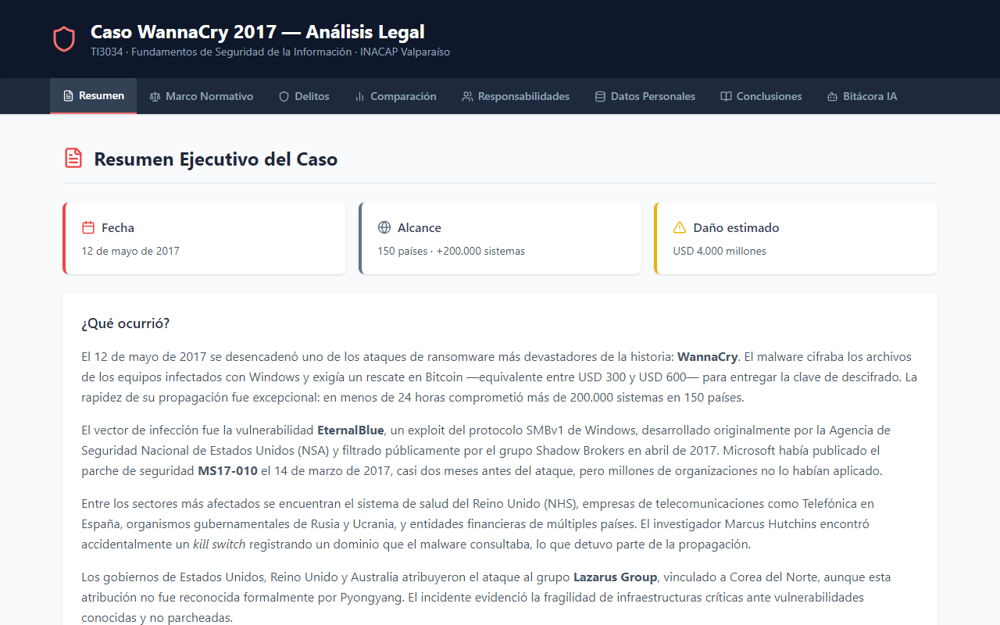

<div align="center">


[](https://github.com/Fernandamv96/informe-mundan/actions/workflows/ci.yml)


[](LICENSE)

</div>

Informe web interactivo sobre el **ataque de ransomware WannaCry (mayo de 2017)** desde la perspectiva legal: marco normativo, delitos informáticos involucrados, comparación entre jurisdicciones, responsabilidades y protección de datos personales. Ramo **TI3034 · Fundamentos de Seguridad de la Información (INACAP Valparaíso)**.

**Demo:** <https://informe-mundan.vercel.app>



## ¿Qué problema resuelve?

Convierte un informe académico extenso en una lectura navegable por secciones, donde cada pestaña responde una pregunta del análisis (qué pasó, qué ley aplica, quién responde y qué se aprende).

## Secciones

| Pestaña | Contenido | Fuente en el repo |
|---------|-----------|-------------------|
| Resumen | Fecha, alcance, vector (EternalBlue / MS17-010) e impacto | `docs_mundan/01_resumen_mundan.md` |
| Marco normativo | Leyes y convenios aplicables | `02_marco_mundan.md` |
| Delitos | Tipificación de las conductas | `03_delitos_mundan.md` |
| Comparación | Diferencias entre legislaciones | `04_comparacion_mundan.md` |
| Responsabilidades | Atacantes, organizaciones y proveedores | `05_responsabilidades_mundan.md` |
| Datos personales | Impacto en protección de datos | `06_datos_mundan.md` |
| Conclusiones | Lecciones del caso | `07_conclusiones_mundan.md` |
| Bitácora IA | Prompts usados durante el trabajo | `08_prompts_mundan.md` |

## Stack

React 18 · Vite · Tailwind CSS · lucide-react · Vercel

## Cómo correrlo localmente

```bash
git clone https://github.com/Fernandamv96/informe-mundan.git
cd informe-mundan
npm ci
npm run dev       # http://localhost:5173
npm run lint      # ESLint
npm run build     # build de producción en dist/
```

## Estructura del proyecto

```text
├── src/
│   ├── App.jsx              # encabezado + navegación por pestañas
│   └── components/          # Resumen, Marco, Delitos, Comparacion, Responsabilidades,
│                            # Datos, Conclusiones, Prompts
├── docs_mundan/             # el informe en Markdown (fuente del contenido)
└── index.html
```

## Qué aprendí

- A analizar un incidente desde el derecho y no solo desde lo técnico: tipificación, jurisdicción y responsabilidades.
- Que un parche disponible (MS17-010) no sirve si no hay gestión de parches.
- A estructurar un informe largo como una interfaz navegable en React.
- A documentar el uso de IA en un trabajo académico (bitácora de prompts).

## Licencia

[MIT](LICENSE) © 2026 Fernanda (Fernandamv96)
